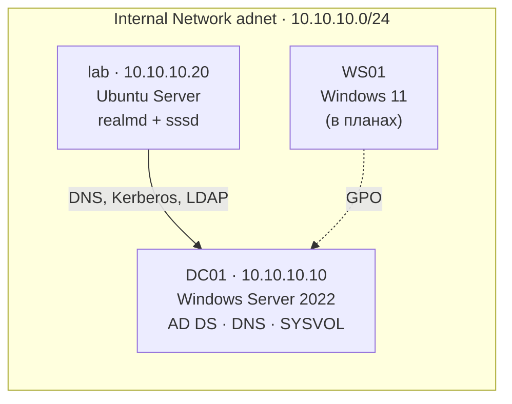

# homelab-ad

Домашняя лаба Active Directory: контроллер домена на Windows Server 2022, Linux-клиент в домене и типовые задачи первой линии поддержки — от сброса пароля до поиска источника блокировки учётной записи по журналам контроллера.

> Статус: в работе. Следующий этап — клиент на Windows 11 и групповые политики (GPO).

## Схема



## Что настроено

| Компонент | Детали |
|---|---|
| Домен | `corp.lab` (NetBIOS `CORP`), один контроллер DC01 |
| DNS | прямая зона `corp.lab` (A, SRV), обратная зона `10.10.10.in-addr.arpa` (PTR) |
| Структура | OU `Company` → `Users\{IT, Accounting}`, `Computers`, `Groups`; группы `GG_IT`, `GG_Accounting` |
| Пользователи | создаются скриптом из CSV, при первом входе обязаны сменить пароль |
| Новые компьютеры | попадают в `Company\Computers` (`redircmp`), а не в стандартный контейнер, к которому нельзя привязать GPO |
| Политика блокировки | 5 неверных паролей → блокировка на 15 минут |
| Аудит | включён аудит неудачных попыток Kerberos (событие 4771) |
| Linux-клиент | Ubuntu введена в домен через `realm join`, вход доменными учётками, домашняя папка создаётся при первом входе |

`.local` для имени домена не использован: эта зона занята mDNS и конфликтует на macOS. В рабочей среде берут поддомен своего домена, например `ad.company.ru`.

## Развёртывание

### 1. Контроллер домена (PowerShell на DC01)

```powershell
New-NetIPAddress -InterfaceAlias "Ethernet" -IPAddress 10.10.10.10 -PrefixLength 24
Set-DnsClientServerAddress -InterfaceAlias "Ethernet" -ServerAddresses 127.0.0.1
Rename-Computer -NewName DC01 -Restart
Install-WindowsFeature AD-Domain-Services -IncludeManagementTools
Install-ADDSForest -DomainName corp.lab -DomainNetbiosName CORP -InstallDns
Add-DnsServerPrimaryZone -NetworkId "10.10.10.0/24" -ReplicationScope Forest
```

DNS контроллера указывает на него самого: в зоне `corp.lab` лежат SRV-записи, по которым клиенты находят контроллер. Публичный DNS о них не знает.

### 2. Структура домена

```powershell
.\scripts\01-structure.ps1
```

Скрипт идемпотентный: повторный запуск пропускает существующие объекты. Пароль новых пользователей запрашивается при запуске и в репозитории не хранится.

### 3. Ubuntu в домене

```bash
# /etc/netplan/60-ad.yaml: enp0s8 = 10.10.10.20/24, nameservers 10.10.10.10, search corp.lab
sudo netplan apply
dig -t SRV _ldap._tcp.dc._msdcs.corp.lab +short      # должен вернуть dc01.corp.lab
sudo apt install -y realmd sssd sssd-tools libnss-sss libpam-sss adcli samba-common-bin oddjob oddjob-mkhomedir packagekit
sudo realm join -U Администратор corp.lab
sudo pam-auth-update --enable mkhomedir
id ivanov.i@corp.lab
```

## Задачи первой линии

| Заявка | Команды |
|---|---|
| Забыл пароль | `Set-ADAccountPassword user -Reset`, `Set-ADUser user -ChangePasswordAtLogon $true` |
| Сотрудник уволился | `Disable-ADAccount user` — отключить, а не удалять: удаление уничтожает SID, вместе с ним права и связи |
| Учётка заблокирована | `Search-ADAccount -LockedOut`, `Unlock-ADAccount user` |
| Учётку постоянно блокирует | найти источник: событие 4740 → если имени компьютера нет, 4771 (Kerberos) / 4625 (NTLM) → IP → имя через DNS |

Поиск источника блокировки (вывод сохранён в `docs/`):

```powershell
Get-WinEvent -FilterHashtable @{LogName='Security'; Id=4771} -MaxEvents 5 | ForEach-Object {
    [pscustomobject]@{ Time=$_.TimeCreated; User=$_.Properties[0].Value
                       IP=$_.Properties[6].Value; Status='0x{0:X}' -f $_.Properties[4].Value }
} | Format-Table
```

`0x18` — неверный пароль, `0x12` — учётка отключена или заблокирована, `0x25` — расхождение времени больше 5 минут.

## Траблшутинг: что встретилось на практике

**`realm join` → `Failed to join the domain`.** Сообщение ничего не объясняет; причина в журнале: `journalctl REALMD_OPERATION=<id> --no-pager`. DNS, LDAP и NetLogon прошли, а аутентификация — нет: `Client 'Administrator@CORP.LAB' not found in Kerberos database`. На русской Windows Server встроенный администратор называется `Администратор`. Надёжный способ узнать имя в любой локализации — по SID: `Get-ADUser -Filter "SID -like '*-500'"`.

**Скрипт написал `Done.`, а все пользователи отключены.** Пароль не прошёл требования сложности домена: `New-ADUser` создал учётки без пароля и отключёнными, а скрипт пошёл дальше. Диагностика — пустой `PasswordLastSet`. Исправление: `-ErrorAction Stop` и `try/catch`, при ошибке скрипт сообщает о ней и завершается с кодом 1.

**Пустой `PasswordLastSet` после сброса пароля — не ошибка.** Флаг «сменить пароль при входе» хранится как `pwdLastSet = 0`.

**В событии 4740 пустое «Имя вызывающего компьютера».** Имя передаёт Windows-клиент; Linux, телефоны и принтеры его не передают. Следующий шаг — событие 4771 с IP-адресом клиента.

**Событий 4771 нет.** По умолчанию контроллер не аудирует неудачные попытки Kerberos. Включение через GUID подкатегории (названия переведены в русской версии): `auditpol /set /subcategory:"{0CCE9242-69AE-11D9-BED3-505054503030}" /failure:enable`. Вывод: отсутствие события в журнале ничего не доказывает, пока не проверен аудит.

**`nslookup` показывает сервер как `UnKnown` и пишет `DNS request timed out`.** nslookup сначала ищет имя самого DNS-сервера обратным запросом, а обратной зоны не было. Решение — обратная зона и PTR-запись для DC01.

## Проверка

```powershell
.\scripts\00-verify.ps1      # отчёт о состоянии домена -> docs/verify-dc.txt
```

## Структура

```
.
├── scripts/
│   ├── 00-verify.ps1        # отчёт о состоянии домена
│   ├── 01-structure.ps1     # OU, группы, пользователи, redircmp, политика блокировки
│   └── users.csv
└── docs/                    # вывод проверок
```
